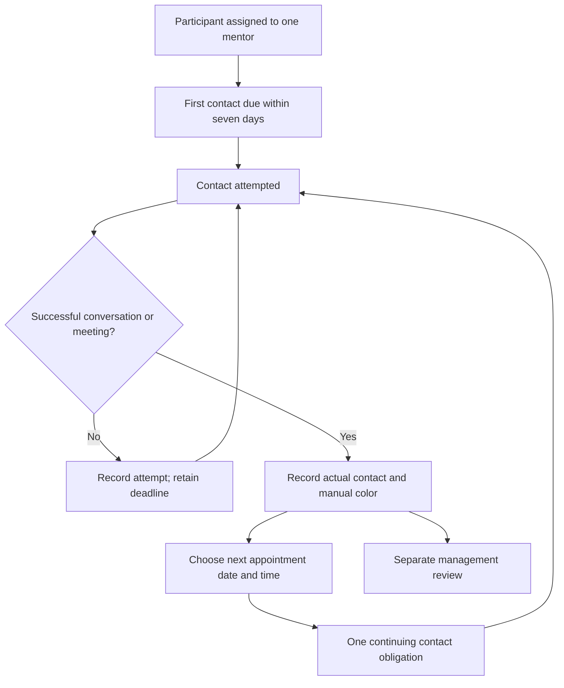

# Mentoring system product specification

Version 0.3 · 26 October 2026 · Working draft; shadcn component foundation and technical contracts added

The product gives the staff of שירות עם משמעות a dependable way to maintain personal contact with every assigned participant at least once every seven days. A mentor records what happened, chooses the next appointment, and keeps an accountable history that coordinators and the CEO can review.

This specification consolidates the client's answers in this conversation. The latest explicit answers take precedence over the initial website outline. The original temporary DOCX is not being presented as freshly verified evidence. The current repository implements the public website; the staff product described here is new implementation scope.

## 1. Decision status and authority

- **Confirmed:** explicitly stated or subsequently clarified by the client.
- **Proposed:** a recommended way to make a confirmed need usable and testable; it is not yet a client commitment.
- **Open:** a decision needed to fix behavior, estimate scope, or accept delivery.

**Project-owner implementation decision:** use actual functional shadcn/ui components, customized with a blue semantic theme. The current HTML wireframe is a flow reference. Its styling is not the approved production visual target. This decision does not close the client's outstanding business-policy questions.

The CEO has final product authority, including disagreements. The developer prepares recommendations and delivery evidence. Coordinator authority, CEO protection details, and exceptions are defined below or identified in the [decision register](decision-register.md). The board chair is a stakeholder; a separate chair account/permission set has not been requested.

## 2. Problem and desired outcomes

The organization reports that close, consistent mentoring is currently missing. It wants to support participants' emotional, physical, and religious/spiritual wellbeing throughout national or military service and to operate that support professionally.

The software's direct responsibility is reliable follow-up, accountable records, reminders, and management visibility. Improvement in participants' wellbeing or religious strengthening is an organizational outcome evaluated from mentor records and management judgment; it is not a guaranteed software acceptance result or a meaning assigned to a status color.

| Goal | Measurement approach | Status |
| --- | --- | --- |
| Every assigned participant receives completed personal contact within the agreed seven-day interval. | Due/completed/overdue records using assignment and actual contact times. The product must surface each missed deadline in testing. | Confirmed cadence; proposed reporting presentation. |
| Mentors record activity at least weekly. | Reporting coverage and missing entries. Whether the completed-contact entry itself fulfils the separate weekly report is D-04. | Confirmed reporting need; exact completion rule open. |
| Coordinators can identify missing follow-up and take over when needed. | Visibility of overdue cases, responsible staff, history, and coordinator actions. | Confirmed need; response deadlines open. |
| Management can review activity and participant progress monthly. | Internal review of mentor-authored records; proposed counts of participants, contacts, on-time contacts, and overdue cases. | Confirmed review; report format and numeric targets open. |

No survey scale, clinical assessment, numeric wellbeing target, or automated judgment of a mentor's performance is agreed. A lack of a recorded contact is an operational indicator requiring review, not proof of what happened outside the system.

## 3. Users and responsibilities

| Role | Responsibility | Confirmed access baseline |
| --- | --- | --- |
| Mentor / חונכת | Own the relationship, complete contact, enter notes and manual color, and set the next date/time. | View and edit assigned participants; no access to other mentors' participants without an explicit CEO grant. Cannot approve or delete. |
| Coordinator / רכזת | Assign and oversee mentors, review records, approve, and intervene when a mentor does not respond. | View/edit/approve; add staff. Exact team-versus-organization scope and reassignment permissions remain open. |
| CEO / מנכ״ל | Final decisions, organization oversight, access grants, protected changes, account revocation, and deletion. | Full control. Can view/edit/approve/delete, manage grants, and mute their own notifications. |
| Participant / חניכה | Receive mentoring outside the system. | Does not enter mentoring records or questionnaires; receives no system messages. A future joining-request flow is unresolved, not a participant portal commitment. |

There is one primary mentor per participant. CEO involvement is required for replacement. Other staff may provide contact, but this does not silently transfer primary accountability; recording permissions for substitute contacts remain to be agreed.

## 4. Proposed first-release boundary

The boundary below is a recommendation for scope review. The client has not yet approved a complete included/deferred list.

| Included in proposed V1 | Priority | Basis |
| --- | --- | --- |
| Functional shadcn/ui foundation, coherent blue theme, Hebrew RTL, and production component states. | P0 | Required by the project owner; exact final screen design is developed using the real components. |
| Staff sign-in using username/password and a one-time code; account administration. | P0 | Confirmed. OTP channel and recovery flow open. |
| Partial participant profiles, national/military service details, assignment, and history. | P0 | Confirmed. Military-specific fields open. |
| Mentor home and participant list focused on next contact and missed follow-up. | P0 | Initial brief plus confirmed weekly need. |
| Completed-contact and unsuccessful-attempt records, manual color, notes, and next appointment. | P0 | Confirmed. |
| Seven-day deadline tracking and staff reminders. | P0 | Confirmed need; exact arithmetic and notification policy open. |
| Coordinator oversight, separate approval, and CEO-controlled access/protection. | P0 | Confirmed; detailed approval/protection policy open. |
| Authorized offline viewing/editing, local autosave, synchronization, and CEO conflict review. | P0 | Confirmed, not a future enhancement. Availability/revocation/cache guarantees need technical design. |
| SMS to staff, with CEO self-mute. Other channels configurable if included in the agreed channel list. | P0 | SMS and preferences confirmed; other channel commitments open. |
| Basic internal monthly oversight view. | P1 proposal | Monthly review confirmed; a custom report builder or export is not agreed. |

| Not included in the proposed implementation baseline without an explicit scope addition | Reason/status |
| --- | --- |
| Participant mentoring accounts, self-completed mentoring questionnaires, participant notifications. | Client explicitly says staff enter mentoring information and participants receive no messages. Joining-request intake remains a separate open decision. |
| General task/project management and a full weekly/monthly scheduling product. | Initial outline included tasks/calendar; later answers did not settle delivery behavior. Propose deferral, while retaining the required next-appointment date/time and upcoming-contact list. |
| Public joining-request form/self-registration, attachments/document management, structured questionnaire tooling. | Intake was deferred; profile-content discussion alone does not define these workflows. |
| External calendar/CRM synchronization, historical migration, advanced search/filtering, custom report builders. | No defined launch requirements; propose deferral. |
| English staff UI, native mobile apps, offline first-time onboarding. | Hebrew is the default; these are not agreed first-release capabilities. Responsive web and authenticated offline use remain in scope. |

Scope may be changed by the CEO, but the changed requirement, design, acceptance criteria, and delivery impact must be recorded. A later configurable feature is still implementation scope; “management can change settings” does not imply arbitrary no-code modification of every workflow.

## 5. Main user journeys

1. **CEO/coordinator onboards staff:** create the staff account, assign role/scope, collect required staff mobile, and complete the agreed sign-in setup. The CEO can revoke access.
2. **Staff adds and assigns a participant:** save available profile information, select one primary mentor through the authorized process, and record the assignment time. This starts the first-contact deadline.
3. **Mentor performs contact:** open an assigned participant, make a call or meet in person, record actual outcome and time, add notes/manual color, and choose the next appointment date/time after successful contact.
4. **Mentor records an unsuccessful attempt:** retain the attempt and notes; keep the previous completed-contact time and obligation unchanged.
5. **Coordinator follows up:** inspect overdue cases, review attempts and notes, contact the mentor or participant as appropriate, and record intervention. Reassignment follows the CEO's process.
6. **Management reviews:** approve records separately, inspect protected changes/conflicts, and review mentoring activity monthly.

## 6. Contact cadence and scheduling

| ID | Rule | Status |
| --- | --- | --- |
| R-01 | The first completed contact is due within seven days of assigning the participant to a mentor. Enrollment approval alone is not the clock start. | Confirmed. |
| R-02 | Subsequent completed contacts are due within seven days of the most recent completed contact, using the actual contact time. | Confirmed. |
| R-03 | A completed phone conversation or in-person meeting qualifies. The method is retained in history. A sent message, visit attempt, or unanswered call is not automatically treated as completed contact. | Phone/in-person and no-answer rule confirmed; any additional qualifying methods open. |
| R-04 | Every completed contact requires the mentor to choose the next appointment's date and time. An unsuccessful attempt must not require inventing a completed meeting or reset the clock. | Confirmed. |
| R-05 | Additional completed contacts are welcome and must not accumulate a second mandatory meeting in the same period. Keep one active next required appointment, replacing/updating it as appropriate. | Non-accumulation confirmed; one-active-appointment representation proposed. |
| R-06 | Rescheduling changes the intended next appointment, not the actual last completed contact. It must not erase a seven-day breach. | Proposed protection of confirmed cadence. |
| R-07 | An incomplete autosaved form remains a draft. Proposed finalization requires a qualifying outcome, actual contact time, and next appointment date/time; entering a call time alone does not submit a completed-contact record. Preserve incomplete input and show the missing scheduling action, without resetting the accepted contact clock. | Proposed draft/validation behavior; required next date/time confirmed. |
| R-08 | A submitted valid contact takes effect without waiting for management approval. Online, central tracking updates when the system accepts it; offline, the local view updates as pending synchronization until the central system receives and accepts it. | Approval independence confirmed; explicit synchronization distinction required by offline operation. |

Conceptually: `firstDueAt = plusSevenDays(assignmentAt)`; thereafter `dueAt = plusSevenDays(lastCompletedContactAt)`. The draft recommends seven local calendar days at the same time in `Asia/Jerusalem`; 168 elapsed hours versus local-calendar arithmetic across clock changes must be resolved in D-02 before boundary tests are finalized.

The next chosen appointment and the latest permitted contact deadline are distinct values. An earlier appointment can be missed before the seven-day limit. Whether a late appointment is blocked or allowed with a warning is open. The model must retain enough history to show that a contact occurred late even after a later completed contact resets the current clock.

For newly assigned participants with no completed contact, use the assignment time. Behavior on reassignment, service pause/completion, corrected contact times, future-dated entries, and deletion is in the decision register; none may silently fabricate successful contact.

## 7. Manual color and calculated follow-up

**Confirmed:** the mentor selects green/orange/red. The colors describe follow-up activity, not emotional health, safety risk, or religious standing.

| Mentor-selected color | Client meaning |
| --- | --- |
| Green / ירוק | Meeting completed. |
| Orange / כתום | Follow-up delayed. |
| Red / אדום | No completed meeting for seven days; coordinator intervention is required. |

**Proposed design:** retain the mentor's reported color and calculate a separate deadline indicator. Do not silently change the manual color. Show the deadline indicator prominently when it disagrees with the manual color, and make the discrepancy visible to the coordinator. New records can display “טרם עודכן” until a mentor chooses a color rather than fabricating a clinical or follow-up assessment.

Suggested calculated labels are `within_interval`, `appointment_missed`, `seven_day_overdue`, and `next_appointment_missing`. A missing-next-appointment action can coexist with time compliance for a newly assigned participant before scheduling, or when a previously accepted contact exists but its future appointment is subsequently removed through an authorized process. It does not make an incomplete contact draft count under proposed R-07. Seven-day overdue takes priority over a merely missed appointment. Exact boundary equality is D-02. These are implementation-independent design recommendations, not additional client-approved colors.

## 8. Profiles, records, and review

| Item | Minimum concept | Status |
| --- | --- | --- |
| Participant | Stable internal identifier; available display/contact/service information; primary mentor; assignment history; mentoring lifecycle. | Partial records confirmed; minimum identity fields and lifecycle states open. |
| Contact entry | Participant, author, actual occurrence time, method, outcome, notes, linked next appointment, revision/review metadata. | Core confirmed; required narrative fields and correction rules open. |
| Appointment | Participant, responsible mentor, intended date/time, replacement/history relationship. | Required next date/time confirmed; detailed lifecycle proposed. |
| Manual color | Color, author, set time, optional reason, history of changes. | Manual choice confirmed; reason and history presentation proposed. |
| Review | Record revision, reviewer, result, reviewed time, comments. | Management approval confirmed; exact statuses and reapproval rules open. |
| Assignment | Participant, primary mentor, effective time, author, CEO authorization/reassignment history. | Single accountability and CEO involvement confirmed; approval mechanics open. |
| Staff | Account, role/scope, staff mobile, active/revoked state, grants and notification preferences. | Confirmed; OTP channel/recovery open. |
| Change/conflict | Author, base revision, local change, authoritative version, resolution and resolver. | CEO conflict preservation confirmed; general conflict policy open. |

Phone and email fields use LTR input within the Hebrew RTL interface. Participant mobile numbers are internal contact information and are never added to notification recipients. Military-specific fields require client definition; do not guess units, sensitive identifiers, or mandatory military details.

Editing or management review must preserve attribution. Proposed approval states are `awaiting_review`, `approved`, and `returned_for_correction`. Editing an approved revision should mark that approval as needing review rather than falsely attaching it to new text. Whether a correction invalidates a previously qualifying contact needs a defined authorized process. No approval action silently resets a contact deadline.

## 9. Permission and authority contract

| Action | Mentor | Coordinator | CEO |
| --- | --- | --- | --- |
| View participant/contact data | Assigned participants or explicit grant | Authorized scope; exact scope open | All |
| Add/edit participant or contact data | Assigned scope, subject to CEO protection | Authorized scope, subject to CEO protection | All |
| Approve records | No | Yes, in authorized scope | Yes |
| Add staff | No | Yes; roles/grant ceiling open | Yes |
| Replace primary mentor | Through authorized CEO-involved process | Through authorized CEO-involved process | Final authority |
| Expand access | No independent grant authority | CEO-delegated authority only if agreed | Yes |
| Delete organizational data | No | No | Yes; deletion type/retention process open |
| Revoke staff access | Not granted | Not granted unless CEO delegates | Yes |
| Disable own mandatory SMS | No | No | Yes |

CEO changes are protected everywhere, including against delayed offline edits. The exact protected object/field boundaries, unlock/delegation process, and record types are D-06. The design may not promise that a coordinator or mentor can overwrite them.

Scope applies to list results, detail views, direct URLs, exports if later added, notifications, and offline caches. Hiding a menu item is not an access-control acceptance test. Successful access changes must be attributed. The CEO cannot grant the product a capability that has not been built; configurable access is distinct from changing product scope.

## 10. Offline, autosave, and synchronization

**Confirmed:** authorized viewing and editing must work without internet; entered information autosaves. If an offline edit conflicts with a CEO change, keep the CEO version authoritative and preserve the mentor's version for review.

**Proposed working model:** after an authenticated online preparation/synchronization, keep the authorized working set available on that device, including records previously loaded into that working set. This is a proposal for a deliverable offline guarantee, not a claim that an unprepared device can retrieve unseen server records without connectivity. Full working-set preparation, storage bounds, and offline sign-in/session duration remain open.

| User-visible state | Meaning |
| --- | --- |
| נשמר במכשיר | Current edits are durably saved locally. This does not mean another staff member can see them. |
| ממתין לחיבור | Changes await an online synchronization attempt. |
| מסונכרן | The central system accepted the current revision. |
| נדרשת בדיקה | A conflict or access/protection change prevented automatic acceptance. Local work remains identifiable for the agreed review process. |
| השמירה במכשיר נכשלה | Local persistence did not succeed; show a recoverable error instead of a success indication. |

No successful synchronization or SMS delivery is implied by local autosave. Duplicate retries must not create duplicate contacts or messages. A locally recorded successful contact can update the local preview of the deadline, visibly pending synchronization; other devices and central reminders cannot rely on it until received centrally. Late-arriving contact data must be evaluated by occurrence time and delivery history so that it does not generate stale reminders after synchronization.

The agreed CEO-conflict flow is: preserve both versions → retain the CEO version as authoritative → flag the mentor revision for authorized review → record the chosen resolution. Ordinary staff-versus-staff conflicts require a separate policy. Deletion, reassignment, session expiry, lost-device/cache retention, and revoked-account behavior must be resolved in technical design before “full offline support” is accepted. A disconnected device cannot learn of a remote revocation instantly; the product's agreed access-validity window must make that limitation explicit.

## 11. Notifications

- SMS is mandatory for ordinary staff accounts. The CEO can mute messages sent to their own account without muting organizational reminders.
- No participant or developer is a recipient merely because their details exist in a profile or project.
- Messages include only agreed minimal contact-reminder information: participant reference/name and appointment date/time. Notes, personal difficulties, and meeting summaries are not proposed SMS content.
- Staff mobile numbers are required for the SMS flow. Missing or invalid staff numbers need an administrative action, not silent delivery success.
- Exact recipients remain open: relevant mentor/coordinator/CEO versus organization-wide broadcasts. The proposed baseline routes by assignment and oversight scope.
- Reminder offsets, overdue repetition, escalation timing, additional channels, quiet periods, and delivery failure handling are open. Reminders cannot be snoozed to change a contact obligation.
- Central scheduling requires connectivity. The UI must distinguish queued, provider-accepted, delivered where verifiable, and failed states. Provider acceptance is not proof of handset receipt.
- OTP delivery, expiry/retry/recovery, and whether a code is required on every sign-in must be specified before authentication implementation.

No SMS/authentication provider is selected or provisioned by this specification.

## 12. UX and operating targets

The [UX design](ux-design.md) proposes a Hebrew-first RTL responsive staff web application. Use actual shadcn/ui components with a coherent blue semantic theme, as defined in the [component specification](component-spec.md). Reuse the organization's techelet/navy identity while designing the real components to a higher visual standard. The [visual design system](design-system.md) supplies styling principles and initial token references. The main mentor action is recording contact and choosing the next appointment. The HTML wireframe appearance is not the production design target or a substitute for functional shadcn components.

Proposed acceptance targets: keyboard-operable controls, visible focus, status text alongside color, programmatic form labels, understandable save/error messages, usable 200% zoom, and touch targets of at least 44 CSS pixels. These are design targets, not a certification or legal-compliance claim. Agree a named browser/device matrix, accessible-user testing expectations, volume, and response-time targets before committing to “all devices/browsers.”

The client has not established whether the approximate count of ten refers to staff, participants, or simultaneous users. The design uses fictional small-cohort examples and does not use that number as a scale guarantee.

## 13. Acceptance scenarios

These scenarios are a review/test contract, not evidence that the product exists or has passed testing. `C` verifies a confirmed rule; `P` verifies a proposed behavior if adopted; `O` depends on an open decision.

| ID | Basis | Given / when | Expected result |
| --- | --- | --- | --- |
| AC-01 | C/O | A participant is approved but not assigned; then assigned to a mentor. | First-contact timing starts at assignment. Exact unassigned-work handling and deadline arithmetic follow D-02/D-09. |
| AC-02 | C | A mentor records an unanswered call. | An attempt appears in history. Last completed-contact time and the seven-day deadline do not reset. |
| AC-03 | C | A completed phone call is recorded with its actual time and the next date/time. | Method is phone, contact tracking updates immediately, and management approval is not a precondition. |
| AC-04 | C/P | A second successful contact occurs before the planned appointment. | Preserve both history entries and one continuing required appointment; do not add another weekly obligation. |
| AC-05 | P | An overdue participant's appointment is moved into the future. | The existing completed-contact time and overdue fact remain unchanged. |
| AC-06 | C/P | A mentor chooses green while the calculated contact deadline is overdue. | Preserve manual green. Under the proposed separation, show an independent overdue indicator and coordinator attention item. |
| AC-07 | C | A mentor submits valid contact online and the central system accepts it; a coordinator reviews it later. | Contact tracking updates before management approval. Reviewer identity/result are separate from the author's entry. |
| AC-08 | C | A mentor opens another mentor's participant through a direct link or cached view without a grant. | No unauthorized record is disclosed. Reassignment/revocation timing follows the separately agreed offline validity policy. |
| AC-09 | C/O | A coordinator adds staff, then attempts to delete a participant or alter a protected CEO change. | Staff creation is allowed within agreed limits; deletion and CEO-protected overwrite are denied. Protection boundaries follow D-06. |
| AC-10 | C/O | An authorized user works offline, edits information, closes/reopens the app, then reconnects. | Recover the locally saved work to the extent of the agreed offline persistence guarantee; distinguish local save from central acceptance. Exact persistence/recovery guarantee is D-07. |
| AC-11 | C | A mentor's offline edit is based on a version subsequently changed by the CEO. | CEO version remains authoritative; mentor revision is preserved for review without silently replacing the CEO change. |
| AC-12 | C/O | A revoked or reassigned user's device reconnects with pending changes. | Enforce current server permissions before central acceptance; apply the agreed pending-work and cache policy without pretending it was already synchronized. |
| AC-13 | P | A reconnect retries the same contact several times. | One contact entry and one logical reminder action result, with no duplicate weekly obligation. |
| AC-14 | C/O | Ordinary staff try to disable mandatory SMS; CEO mutes their own messages. | Ordinary staff cannot disable mandatory SMS; CEO self-mute works. Controlled delivery testing follows the agreed recipient/timing policy. |
| AC-15 | C | A participant has a mobile number and a completed-contact entry. | Participant mobile is usable by staff but is not a notification recipient. |
| AC-16 | C/O | Staff save a partial participant record and later correct it. | Available information is retained; exact minimum identity fields follow D-09. |
| AC-17 | C/O | Management reviews a month of records. | Authorized staff can inspect relevant activity and narrative records. Any agreed reporting calculations distinguish activity counts from participant-reported outcomes. |
| AC-18 | P/O | Mentor, coordinator, and CEO journeys run on the agreed desktop/mobile matrix with keyboard and zoom. | Content, date/time controls, authorization states, and save messages remain usable under the agreed accessibility/browser targets. |
| AC-19 | C/O | Compare a never-contacted assigned participant immediately before, at, and after assignment plus seven days. Repeat for a participant with a completed contact using its actual time. | Each deadline uses its correct starting event; warning/breach boundaries follow D-02. A new appointment or failed call does not move either contact deadline. |
| AC-20 | C/P/O | A completed-call form contains an actual time but lacks the next appointment. | Under proposed R-07, retain an incomplete local draft and show the missing field; do not submit a completed-contact entry or reset its clock. Finalize only when required information is supplied. |
| AC-21 | C/P | A mentor finalizes a valid contact offline while another device still has the last synchronized record. | Show the local contact and deadline as pending synchronization. The other device retains its last accepted central state. Management approval is not the gate; central receipt/acceptance is required for shared tracking and reminders. |

## 14. Delivery readiness and handover

The draft is ready for product/UX review. It is not yet a fixed-scope implementation SOW. Resolve the launch-blocking items in the decision register before promising the complete build, especially offline guarantees, access/protection scope, notification/authentication behavior, intake, and acceptance terms.

Recommended phases are product agreement → reviewed desktop/mobile interactions → technical design and external-integration discovery → implementation → controlled acceptance/pilot → handover. There is no agreed schedule or pilot size. Code/data/service-account ownership, training, support, defect thresholds, acceptance window, and maintenance responsibility require explicit terms.

For implementation, retain this repository's installed-version Next.js documentation rule. The [technical specification](technical-spec.md) defines the proposed data, transaction, authorization, offline, and notification contract; the [implementation plan](implementation-plan.md) sequences the work. Select and provision external services only during the authorized integration-design/build stage using the applicable marketplace guidance. A design preview is not provider integration, deployed software, message delivery, or accepted offline behavior.
