# Mentoring system technical specification

Version 0.4 · 27 October 2026 · Contract and development implementation status

This document turns the confirmed mentoring rules into implementable data, authorization, synchronization, and notification contracts. Read it with the [product specification](product-spec.md), [component specification](component-spec.md), [decision register](decision-register.md), and [implementation plan](implementation-plan.md).

**Confirmed** labels describe client/project-owner requirements. **Proposed technical default** labels describe a design the implementation team can adopt or refine. A technical default does not close an unanswered product-policy decision. No application, database, provider integration, or account provisioning is delivered by this document.

The current `/staff` implementation uses real development Clerk and Neon resources, functional blue-themed shadcn components, transactional commands, an authorized IndexedDB working set, and a stable outbox. Contact correction/history, authority/lifecycle management, monthly oversight/settings, full administrative offline intent and reminder diagnostics have been added. The [readiness ledger](readiness.md) maps every AC/TA requirement to source, verification and remaining gates. Implemented source is not evidence of a passing final run or production acceptance.

Recorded bounded local implementation/testing is closed. Build `ZtyXUj8St-E_Hpz8dB7UQ`, 400 tests, lint/typecheck/HTTP, Chrome 12/Firefox 15 and updated-WebKit 15 functional groups pass. Current Chrome proves strict-19 native drafts, assigned-mentor sync-once/dedup and measured styles; cleanup is exact. Full fixed-runtime WebKit **15/2/1** includes native exact-draft/five-route/reconnect and retains unconfirmed automatic post-verification navigation within ten seconds plus strict no-errors failure with 44 CORS-shaped diagnostics. Legitimate Continue worked; no cause or unexpected failed RSC chain was established. Historical 28/2/1 and focused 6/1/2 remain separate; vendor probe and actual Safari/iPhone are untested.

The old 1.62.1 native failure matches [upstream evidence](readiness.md). Isolated 1.64.1/WebKit 27.2 r2370 passes measured native recovery with no app/bundled/global dependency changes. The earlier focused diagnostic resolves to `loadAuthoritative`'s workspace GET, caught in `synchronizeUnlocked`; its network-error path restores valid leased local data and keeps fresh recovery gated. Its missing timing/request/failure detail leaves the trigger unattributed. The later full-run diagnostics have no established cause; they are not all attributed to that catch path. Source-only auth review found no concrete app bug. No fix, cancellation/offline explanation or zero-diagnostics claim is made.

## 1. Architecture boundary

The implementation uses the repository's Next.js/React/Tailwind foundation and real shadcn/ui components with a shared blue theme. The `/staff` route namespace and separate staff layout keep it distinct from existing public routes, contact forms and public content. Future framework changes must follow the installed-version documentation rule in `AGENTS.md`.

**Proposed technical default:** a modular application with one authoritative transactional store, an authorized local working set/outbox, and background notification dispatch. These are logical responsibilities, not a commitment to separate services or a specific hosting/database provider.

```mermaid
flowchart LR
    UI[Staff React UI and shadcn components] --> Local[Authorized durable local records and pending operations]
    UI --> API[Authenticated domain commands and scoped reads]
    Local --> Sync[Reconnect and synchronization]
    Sync --> API
    API --> Policy[Current role scope revision and CEO protection checks]
    Policy --> Store[Transactional authoritative store]
    Store --> Events[Change log and notification outbox]
    Events --> Dispatch[Due reminder dispatcher]
    Dispatch --> Check[Recheck current obligation and recipient eligibility]
    Check --> Delivery[Messaging adapter and delivery evidence]
```

Authentication and authoritative storage use Clerk and Neon in development only. Staff SMS has no selected/configured transport. The adapter boundary and reminder engine do not satisfy real delivery. Production requires separate client-owned Vercel, Clerk and Neon accounts, a settled authentication configuration and a real SMS integration; see [development](development.md).

Clerk's supported first-party proxy is configured at `/__clerk` in the [middleware](../../proxy.ts) and [staff auth provider](../../components/staff/auth/auth-provider.tsx). Public SDK and modern UI real authentication passed. Reviewed public-SDK response normalization resolves the online controlled-reload case while public assets/private authentication remain separate caching classes. It does not establish native offline cold-start acceptance. The future client production domain needs Clerk `proxy_url` enablement/verification as an explicit later account gate.

## 2. Domain and storage invariants

| ID | Invariant | Basis |
| --- | --- | --- |
| T-01 | Every participant has at most one active primary mentor. Assignment history remains attributable. | Confirmed ownership; storage representation proposed. |
| T-02 | The first contact clock starts at assignment. Later clocks use the latest qualifying completed-contact occurrence. | Confirmed. |
| T-03 | Unanswered attempts do not change the last successful-contact time, seven-day deadline, or existing next appointment. | Confirmed. |
| T-04 | Additional completed contact updates one continuing next-contact obligation; it never adds a second mandatory weekly meeting. | Confirmed behavior; one-current-appointment representation proposed. |
| T-05 | Manual mentor color, calculated deadline state, and management approval are different fields. No approval action fabricates contact. | Manual color/approval independence confirmed; separate displayed deadline indicator remains proposed in D-01. |
| T-06 | Contact occurrence, server receipt, and approval times remain separate. Upload/review timestamps do not replace the contact's actual time. | Technical consequence of the confirmed offline/cadence requirements. |
| T-07 | CEO protection persists independently of the most recent editor. An unrelated coordinator edit does not erase it. | Confirmed protection; metadata implementation proposed. |
| T-08 | Current authorization and protection are checked when a queued operation reaches the server. A cached role flag cannot authorize it. | Proposed authorization contract. Offline validity policy remains D-07. |
| T-09 | A review approves one record revision. Later content changes cannot silently inherit that approval. | Proposed review contract; correction effects remain D-04. |
| T-10 | Current data, idempotency receipt, and the corresponding change/outbox event commit together for a domain operation. | Proposed reliability contract. |
| T-11 | Participants' contact details are not messaging recipients. Ordinary staff SMS cannot be disabled; CEO self-mute applies only to the CEO's own delivery. | Confirmed. |

The initial application serves one nonprofit. An `organization_id` ownership boundary is proposed throughout storage and authorization to prevent accidental cross-context reads; it does not add multi-organization administration or a SaaS tenancy product to scope.

## 3. Logical data model

Exact schema names can change during implementation. The concepts and invariants must survive those changes.

| Entity | Essential attributes | Relationship/constraint |
| --- | --- | --- |
| Organization | Identifier, timezone, agreed policy references. | One active organization in the initial product. |
| Staff membership | Account identity, organization, role, active/revoked state, staff mobile, scope revision. | Authentication identity is verified by the chosen integration; application membership governs access. |
| Access grant | Subject, authorized action/resource scope, grantor, effective/revoked time, revision. | CEO-controlled expansion; coordinator grant ceiling remains D-05. |
| Participant | Stable ID, available identity/contact/service data, mentoring lifecycle, revision. | Partial profiles allowed. Minimum identity, military fields, and lifecycle rules remain open. |
| Assignment | Participant, primary mentor, effective time, prior assignment, author/authorization. | At most one active primary assignment; preserve history. Reassignment timing is D-03. |
| Contact entry and revisions | Participant, actor, occurrence/receipt time, method, outcome, notes, revision/correction attribution. | Preserve accepted history through attributable corrections. Invalidated entries follow agreed correction/deletion policy. |
| Next appointment | Participant, responsible mentor, planned date/time, version/generation, source contact. | At most one current required appointment; replacing it preserves history. |
| Manual follow-up report | Participant, manual green/orange/red, author/time, optional explanation, revision. | Can be updated without inventing successful contact; never derived from an approval flag. |
| Management review | Contact/report revision, reviewer, result, review time, comments. | CEO/coordinator authority; statuses/correction effects proposed until agreed. |
| CEO protection | Protected object/field scope, authoritative revision, protecting actor/time, explicit unlock/delegation metadata. | Granularity/unlock policy D-06; protection cannot be inferred only from `last_editor`. |
| Operation receipt | Organization, actor, stable operation ID, payload hash, outcome/result reference, processed time and accepted time where applicable. | Duplicate-safe replay for accepted writes and preserved conflicts; reuse with different content is a conflict. |
| Synchronization conflict | Submitted/base/authoritative revisions, author, cause, status, authorized resolution. | Preserve CEO version and mentor work; ordinary concurrent resolution is D-08. |
| Change/audit record | Operation, object/revision, actor, event/time, reason where required. | Attributed administrative/domain changes; retention/deletion scope D-14. |
| Notification job/attempt | Obligation generation, reminder occurrence, recipient/channel, due time, delivery state, provider reference/evidence. | Separate intended message from each delivery attempt and its outcome. |

Store authoritative instants consistently and retain the organization's IANA timezone for interpreting/displaying appointments. The exact seven-day calendar arithmetic and clock-change boundary are D-02. Keep the selected policy identifiable so a later policy change does not silently rewrite historical compliance.

## 4. Authoritative command contract

**Proposed technical default:** each write carries a stable client-generated operation ID, expected relevant revisions, and the data required for that command. The server derives actor identity/organization from the authenticated context and checks all target ownership and permissions. It does not trust actor/role/organization assertions from the payload.

| Command | Required intent | Acceptance effect |
| --- | --- | --- |
| Create/update participant | Available profile fields and expected revision where updating. | Save partial data under authorized scope. No implied assignment or contact. |
| Assign/reassign participant | Participant, primary mentor, assignment revision, authorized reason/process. | Enforce one primary mentor and preserve assignment history. Cadence effect follows D-03. |
| Record unsuccessful attempt | Participant, actual occurrence, method/outcome, optional notes/manual report, revisions. | Append attempt and explicitly chosen report; leave successful-contact anchor and appointment unchanged. |
| Finalize completed contact | Participant, actual occurrence, qualifying method, notes/manual report as agreed, next date/time, assignment/contact/appointment revisions. | Atomically record contact, replace one next appointment, update derived tracking, and append receipt/change/outbox events. Missing required next details remains a draft under proposed R-07. |
| Reschedule next appointment | Existing appointment generation and proposed date/time. | Change planned time only. Preserve actual contact history and any seven-day breach. Late-date block/warn policy D-02. |
| Change manual follow-up color | Participant, selected color, expected report revision. | Record an attributable manual report; do not fabricate a successful contact. |
| Review a record | Exact revision, authorized result/comment. | Add review evidence separately; later edits require the agreed re-review/correction rule. |
| Correct/invalidate accepted contact | Target contact/revision, expected tracking/appointment revisions, reason, and authority under the agreed correction policy. | Preserve attributable history, apply the agreed qualification/scheduling effect, recompute affected tracking, and supersede affected notification generations atomically. D-04 defines who may do this and which corrections require review. |
| Grant/revoke staff access | Target membership/grant revision and authorized scope. | Update current permissions and audit evidence. Must not be authorized from stale offline metadata. |
| Resolve preserved revision | Conflict ID, expected authoritative revision, authorized resolution. | Preserve CEO protection; record the resolution and resulting revision if any. |
| Delete information | Target, expected revision, CEO authority, agreed deletion intent. | Apply the chosen retention/deletion policy; no unapproved hard-delete implementation. |

The implemented command union is [contracts.ts](../../lib/mentoring/contracts.ts). Feature contracts add contact correction/invalidation, rescheduling and manual color; access grants, CEO protection/unlock, lifecycle, tombstone/restore and staff edits; organization settings and versioned monthly notes; and bounded reminder evaluation. Current deletion is reversible logical deletion. Hard purge is not implemented pending retention policy.

The completed-contact transaction is the core vertical slice. A client must not receive a definitive central success response if the contact was saved but its required next appointment failed. UI suppression of a double click complements, but does not replace, server duplicate protection.

Historical/out-of-order uploads need explicit preconditions. An older real contact may be legitimate history, but it cannot blindly replace a newer current appointment or move the cadence anchor backward. Preserve the submission and return an actionable revision conflict for the agreed correction/review workflow when automatic acceptance is unsafe. The HTML preview's historical-entry restriction is not the production retrospective-entry policy.

Correction/invalidation is a separate domain operation, not a destructive overwrite or a side effect of rejecting a review. Where the agreed policy changes which contact qualifies, recompute the latest valid successful-contact anchor (or the assignment anchor if none remains), retain previous approval as evidence for its original revision, and make the new revision's review status explicit. Apply the agreed effect on the current appointment rather than silently deleting it or inventing a replacement. Commit resulting tracking/obligation-generation changes and notification supersession with the correction. Authority, rejection effects, and appointment handling remain product decisions in D-04.

## 5. Proposed API and error surface

Staff UI uses `GET /api/mentoring/workspace` and `POST /api/mentoring/commands` instead of direct database/provider calls. The separate scheduled entry is `GET /api/internal/mentoring/reminders`, authenticated by exact Bearer `CRON_SECRET` and a server-configured real CEO. It accepts no request-selected scope and is not an offline staff command. The staff contract covers:

- Scoped participant list/detail/history and staff oversight reads.
- Versioned domain commands from section 4.
- A permission-filtered working-set snapshot refreshed after synchronization. A separate incremental-delta endpoint is not implemented.
- Per-operation synchronization acknowledgements and conflict information.
- Review, staff administration, and delivery-evidence reads within current scope.

| Result category | UI behavior |
| --- | --- |
| Centrally accepted | Show the canonical revision and server acceptance. A pending local copy may now become synchronized. |
| Already accepted duplicate | Reuse the accepted result within current authorization; create no duplicate record or appointment. |
| Validation failure | Keep entered data, identify the field/rule, and allow correction. |
| Version/protection conflict | Preserve the pending revision and open the permitted comparison/review action. |
| Authentication required | Preserve the pending work under the agreed local policy and request online sign-in. Do not pretend reauthentication can receive an OTP offline. |
| Access revoked/forbidden | Enforce current access, disclose no unauthorized record, and apply the agreed pending-work/cache policy. |
| Unavailable target | Do not reveal whether an inaccessible participant exists. |
| Retryable connectivity/service failure | Retain the stable operation ID, show pending state, and retry according to a bounded policy. |

Replaying a previously accepted operation still requires a current authorization check before returning protected information. Store a payload identity with its receipt so the same operation ID cannot mean different writes. A batch synchronization response reports each operation separately; one denied item must not falsely mark an entire batch synchronized.

A preserved conflict is also identified by the operation receipt: repeating the same conflicting submission returns the same conflict reference rather than creating another mentor draft for every retry. Recheck access before returning its contents. Resolution or a rebased correction is an explicit new operation, not a silent re-evaluation of the old submission as though it had never produced a result.

Once an operation may have reached the server, its ID and payload are immutable. A local correction becomes a new operation referencing the prior result/revision; editing the payload behind a possibly accepted ID would make safe retry impossible. An unsent draft is separately editable until it is finalized into an outbox operation.

## 6. Authorization and CEO protection

All server reads and writes must establish: authenticated identity → active organization membership → authorized action → current resource/assignment/grant scope → valid revision → CEO protection policy. Apply this to list queries, detail URLs, synchronization snapshots/deltas, approvals, and message-recipient selection. Browser visibility is not authorization.

For writes, current membership/scope/protection validation participates in the same atomic commit or equivalent storage preconditions as the domain change. A middleware check performed before a concurrent revocation or CEO edit is not sufficient. Access changes and record writes need a defined ordering: a revocation/protection change committed before write acceptance must be honored; a previously committed authorized write remains attributable history.

Mentors are limited to assigned participants unless the CEO grants more access. Coordinators can view/edit/approve and add staff within their agreed scope; organization-wide scope and grant ceiling remain unanswered. The CEO is the final authority, can expand access, controls revocation/deletion, and can mute their own reminders.

CEO protection is durable metadata. An authorized change to a different part of a record must not drop it. An explicit authorized unlock/delegation is required where the agreed policy permits another editor. Whether protection locks whole objects or selected fields remains D-06; design the metadata so the chosen policy can be enforced consistently in online and queued edits.

The following **provisional protection contract** is implemented, with current local-suite proof and recorded frozen core/contact PostgreSQL proof after the overly broad lock regression. Those PG checkpoints predate the new optional dispatcher outcome-recording caller; their unchanged assertions are not a fresh populated PG run against newest whole-source hashes. Current browser verification remains. T-07, AC-09/AC-11 and TA-04/TA-06 are unchanged: existing protection remains enforced, and an active whole-record lock never automatically narrows or backfills to a selected-field lock.

| CEO operation | Automatic protection effect |
| --- | --- |
| Create participant | Protect the supplied profile keys; an empty key set adds no protection. |
| Update participant profile | Protect only the submitted profile keys, including an explicitly cleared field. |
| Assign/reassign | Protect only `assignment` on the participant. |
| Change lifecycle | Protect only `lifecycle` on the participant. |
| Logical delete/restore | Preserve existing protection; do not introduce a new whole-record lock. |
| Record/correct/review contact | Retain whole-object protection on the affected contact. A new contact is a new record, not permission to overwrite an earlier protected contact. |
| Record a new completed contact | Begin a new appointment cycle and retain the previous appointment in immutable history. CEO `record_contact` does not create a permanent participant `appointment` lock. |
| Explicit protection, standalone rescheduling, or schedule-changing correction | Honor explicit selected-field/whole-record intent. Existing explicit/standalone-reschedule/correction schedule locks still guard changes and require CEO release. |

Automatic selected fields accumulate without narrowing any active protection. A whole-record or selected-field unlock/replacement remains an explicit authorized, versioned command. Local projections and central commands must agree on this contract, and pending unlocks still cannot increase accepted local authority. Final regression status is in [readiness](readiness.md).

**Superseded proposal:** the earlier online-only administration restriction does not satisfy C-12/U-04. All authorized application commands, including grants, staff membership changes, settings, review, lifecycle, logical deletion/restore and conflict decisions, can be saved as offline intent. Central acceptance always checks current identity, scope, versions and protection on reconnect. Pending grants, role/activation changes, assignment changes or unlocks cannot enlarge readable authority. A queued staff membership is not an authentication-provider account. First-time sign-in/OTP, provider onboarding and enforcement on other devices require network access.

Current provisional authority is CEO-only for grants, protection, lifecycle, logical deletion/restore and staff authority edits. A coordinator can initially assign an unassigned participant to an active mentor in their team; replacement of an existing primary mentor requires the CEO. Pause/close retain the history, cadence anchor and appointment, cancel unsent jobs, and resume without resetting the deadline. New contact, assignment and rescheduling are blocked while inactive; authorized historical correction/review/profile/manual-color work remains available subject to protection. These defaults are recorded against D-03–D-06 in the [decision register](decision-register.md).

## 7. Offline working set and synchronization

The confirmed requirement is offline viewing/editing and autosave for authorized information. The deliverable offline guarantee must define preparation, device support, cache lifetime, session validity, and recovery in D-07/D-14.

**Proposed technical default:** durable structured browser storage for the authenticated working set, drafts, and a stable outbox; an application-shell cache for previously prepared use; and versioned synchronization against the authoritative service. Do not put private participant API responses in shared public caches or mix different staff identities' working sets. Passwords and one-time codes are not mentoring data and must not be copied into this store.

| State | Stored meaning and permitted claim |
| --- | --- |
| Draft | Incomplete locally retained input; does not finalize contact. |
| Queued | A finalized local operation awaits server validation. Local tracking can show its pending effect. |
| Uploading | A synchronization attempt is in flight; loss of connection retains the same operation identity. |
| Accepted | The central service accepted the operation and returned its canonical revision. |
| Conflict | A version/protection change prevents safe automatic acceptance; preserve the submitted work. |
| Access denied | Current permission prevents acceptance; apply agreed restricted recovery/cleanup rather than claiming success. |
| Local-save failure | Durable local persistence failed; do not display “saved on device.” |

The implementation uses a server-issued offline lease bounded to 24 hours; organization settings can shorten it. Mentoring form drafts use the shared durable draft path, distinct from immutable finalized operations; passwords and OTP codes are excluded. The anonymous service-worker shell caches public assets only, not private API/authentication/RSC responses.

Identity/authority changes, denied access and expiry lock private work in a separate quarantine. Payloads are not exposed through a newly signed-in account. Explicit recovery requires fresh online authorization of the same account, organization and membership; inaccessible items stay locked. Recovered pending work remains blocked for review and a fresh action. Explicit logout warns about drafts/pending work before discarding local data. This is an implementation default awaiting D-07/D-14 acceptance, not a promise of instant remote revocation on a disconnected device.

Proposed reconnect sequence:

1. Re-establish or validate the online session and fetch current membership/grants/policy.
2. Apply permitted server changes and assignment/protection changes without silently erasing queued work.
3. Submit operations with stable IDs, expected revisions, and dependency ordering.
4. Receive per-operation acceptance, conflict, validation, or access-denial results.
5. Apply canonical accepted data, retain recoverable conflicts, and reconcile the authorized working set.

If the CEO changed the same protected information while a mentor was offline, the CEO revision remains authoritative and the mentor's version is preserved for authorized review. Ordinary concurrent edits must not silently adopt last-write-wins; their merge/review policy remains D-08.

A disconnected device cannot learn immediately that access was revoked or a participant reassigned. The agreed offline access-validity window must bound this limitation. On reconnection the server enforces current permissions before accepting writes. Disposition of already cached data and pending work requires an explicit product/privacy policy; this spec does not promise retroactive instant revocation or unlimited offline access.

Central reminder dispatch cannot know about an unsynchronized call. A later upload records both actual occurrence and receipt time, distinguishes late reporting from late contact, and may cancel an unsent reminder after revalidation. It cannot retract an SMS that was already sent. Retain the relevant decision and delivery history.

## 8. Notifications and authentication integrations

Required capabilities are authoritative data storage, username/password plus OTP authentication, staff SMS, and recurring reminder execution. Additional channels, intake tools, and attachments are not implicitly included. Existing public contact email delivery is not evidence that staff SMS/OTP or mentoring persistence exists.

| Capability | Integration acceptance requirement |
| --- | --- |
| Authoritative store | Required transactions, constraints, revision checks, safe scoped access, backup/recovery and retention behavior. |
| Authentication/OTP | The agreed credential/code flow, delivery channel, session/recovery behavior, expiry/retry protections, and server-verified identity. |
| Production auth proxy | Enable and verify Clerk `proxy_url` for the future client domain; local `/__clerk` SDK/UI authentication proof is not production domain configuration. |
| Staff SMS | Agreed Israeli staff-number handling, minimal approved message content, eligible recipients, failure handling, and verifiable delivery states where available. |
| Background dispatch | Authenticated recurring execution, duplicate-safe logical jobs, current eligibility checks, bounded retries, and observable failures. |

The development capability inventory found an email integration (Resend), which does not provide the required staff SMS capability. [transport.ts](../../lib/mentoring/features/reminders/transport.ts) defines the provider boundary and deliberately returns no configured transport. A provider must be selected, a real provider-specific adapter implemented, accounts/sender/credentials configured, and controlled acceptance/reconciliation/delivery tested. Adding keys alone cannot complete this work.

The canonical reminder engine and diagnostics support bounded evaluation, generation supersession, current-recipient checks, atomic claims, attempts, lease expiry and uncertain outcomes. [run-reminders.mjs](../../scripts/mentoring/run-reminders.mjs) is a guarded development-only evaluation CLI and sends no SMS. Hosted recurring execution is not configured. The default audience is the responsible mentor/coordinator/CEO; CEO settings can select all staff. Timing, repetition and audience remain provisional D-11 policy.

The [secure scheduled route](../../app/api/internal/mentoring/reminders/route.ts) and [runner](../../lib/mentoring/features/reminders/scheduled.ts) are implemented/frozen with final code/security approval. Exact Bearer `CRON_SECRET` is checked before DB; `MENTORING_REMINDER_ACTOR_ID` must resolve to a real active CEO in the fixed organization. HEAD returns 405. Queries cannot select scope, actor, cursor, recipients or batch size.

The scan processes at most five pages of 200 participants with a cooperative 20-second budget checked between pages; incomplete evaluation returns 503. Complete evaluation invokes a dispatcher batch of at most five with a 10-second budget. `scanComplete`/`more` refer to evaluation, not a drained message queue. Larger workloads require verified continuation; the current contract reports incomplete work rather than claiming completion.

Fresh phases and the final completion check require current CEO authority. The dispatcher's optional `resultTransaction` records only the exact existing claim-token/provider outcome even after actor revocation, preserving already-started external evidence while fresh work stays guarded. Prior callers keep their default behavior. It does not authorize new sends or unrelated writes after revocation.

Actual empty-development route-function/PostgreSQL smoke passed HEAD 405, missing Bearer 401 and authenticated 503 `delivery_blocked`, with one zero-record page, no dispatch outcomes and hosted false; cleanup/source hashes were verified. Separate populated direct-route/default-PostgreSQL integration passed: scanned 3/planned 4 blocked active-assigned jobs, none paused/unassigned; repeat canonical identities/payloads unchanged; three negative authority actors generic 503/jobs unchanged. Registry null, attempts/claims/sends/outcomes zero, all 22 counters zero before/after, full original actor/settings v6/v1 exact and 12 hashes stable. This opt-in result is outside 400 local tests and proves neither hosted execution nor provider delivery. The real SMS adapter and cron deployment configuration remain absent; credentials alone cannot complete SMS.

**Proposed notification design:** commit an outbox event with the accepted domain change. Create reminder jobs tied to the organization, participant, current obligation/appointment generation, reminder occurrence, recipient, and channel. Before dispatch, recheck actual latest contact, planned time, mentoring lifecycle, current recipient scope/account state, and CEO self-mute. A superseded job must not send merely because it was once queued.

Define a dispatch-claim boundary: the dispatcher atomically claims an eligible job while checking its current obligation generation and recipient policy. A superseding contact accepted before that claim prevents stale dispatch. After a valid claim/provider handoff is in flight, a later contact or mute may no longer prevent the external message; retain the claim, subsequent change, and actual delivery evidence rather than promising cancellation up to handset receipt. Use a bounded claim lease/recovery process without treating an uncertain provider result as a definite failure.

Track intent and attempts separately: queued → dispatching → provider accepted → delivered where supported, or failed/uncertain. A provider timeout can mean the send outcome is unknown; do not blindly retry as though nothing was sent or promise exactly-once handset delivery. Use provider-supported duplicate protection and reconciliation where available. Persist delivery evidence without exposing credentials or sensitive narrative notes.

SMS remains mandatory for ordinary staff. Participant numbers and the developer are not recipients. CEO self-mute affects only the CEO's messages. Exact reminder timing, broadcast versus assignment/oversight routing, other channels, and quiet periods remain D-11. OTP destination and account recovery remain D-10.

## 9. Complete vertical-slice acceptance

In addition to product AC-01–AC-21, implementation should demonstrate the following scenarios with real service integration and controlled recipients/data where applicable:

| ID | Scenario | Required evidence |
| --- | --- | --- |
| TA-01 | Submit a completed contact, lose the response, and retry the same operation. | One accepted contact, one current appointment, one logical outbox event, and a recoverable success result. |
| TA-02 | Appointment persistence fails during contact finalization. | Atomic rollback/no false success; local submission remains recoverable. |
| TA-03 | Submit queued contacts out of chronological order. | Cadence follows valid occurrence times; a stale operation cannot replace a newer appointment without the agreed revision/correction process. |
| TA-04 | CEO edits a protected record, then a mentor reconnects with older local changes. | CEO version remains authoritative; mentor submission and review attribution survive. |
| TA-05 | Revoke/reassign before a pending upload; try a direct participant URL and incremental sync. | Current scope governs acceptance and reads; no unauthorized record/result disclosure. |
| TA-06 | A coordinator updates an unrelated field on a CEO-protected record. | Existing protection remains; a subsequent queued overwrite is still checked. |
| TA-07 | Approve revision A, then create revision B. | Approval stays attached to A; B does not silently appear approved. |
| TA-08 | Sync successful contact while an overdue reminder is waiting to dispatch; repeat after a dispatch claim/provider handoff has begun. | Contact accepted before the claim prevents stale dispatch. A later contact does not imply an in-flight external message can be cancelled; preserve ordering and truthful delivery evidence. |
| TA-09 | Provider times out after possibly accepting SMS. | An uncertain outcome is visible and reconciled; retry behavior follows the integration contract rather than assuming exactly-once delivery. |
| TA-10 | Work offline, restart the supported app/browser, fill storage or interrupt persistence, then reconnect. | Demonstrate the agreed recovery guarantee, no false local-save indication, and correct per-operation synchronization. |
| TA-11 | Exercise the mentor/contact/approval flows using actual blue-themed shadcn components on agreed desktop/mobile devices. | Real component behavior, RTL, focus, validation, pending/error states, and backend results; the HTML prototype is not the evidence. |
| TA-12 | Review monthly activity after delayed synchronization. | Actual-contact timing and received/reporting timing remain distinguishable; no invented wellbeing score or misleading completeness claim. |
| TA-13 | Correct or invalidate the latest accepted contact under the agreed policy. | Preserve history and approval attribution; recompute the valid cadence anchor and agreed appointment effect, and supersede stale reminder generations in the same commit. |
| TA-14 | Race a queued write against revocation, reassignment, or a CEO-protection change. | The server's committed ordering governs acceptance; an earlier middleware decision cannot bypass a change committed before write acceptance. |
| TA-15 | Retry the same offline submission after its CEO conflict was already preserved. | Return the same conflict reference within current authorization; do not create duplicate preserved drafts or automatically accept the old payload after policy changes. |

These are acceptance obligations. Test source exists for the implemented contracts, and the [readiness ledger](readiness.md) records which execution evidence applies to the current snapshot. Real-provider TA-08/TA-09 evidence, production browser/device coverage, volumes, accessibility acceptance, controlled SMS recipient authorization, support and handover remain separate gates.

## 10. Decision ownership and readiness

The team can choose operation IDs, revision tokens, transaction boundaries, explicit result categories, component composition, and logical module boundaries without asking the client to design software internals.

The CEO must settle user-facing policy: exact cadence boundaries, lifecycle/reassignment effects, incomplete reporting/correction behavior, coordinator scope and protection/unlock rules, offline validity/recovery limits, reminder recipients/timing, OTP/recovery, included intake/reports, and delivery acceptance. Preserve those decisions in [decision-register.md](decision-register.md). Implementation milestones are in [implementation-plan.md](implementation-plan.md).

Before future deployment, follow the recommendation to use the latest Vercel CLI; the plugin reported the installed CLI outdated. No global tool changes or runtime/deployment actions are part of this documentation update.

The scope audit found no additional settled staff-workflow gap. Ancillary features remain open/proposed deferrals; client/device acceptance, hosted/provider proof and policy decisions prevent a claim that only credentials remain. Recorded local verification retains WebKit's unconfirmed automatic transition and 44 CORS-shaped diagnostics/strict-cleanliness failure. Deterministic quota-write recovery passes; physical exhaustion/contact-response loss remain untested. Final focused settled accessibility **6/1/1** passes eight page audits/nine strict controlled resizes; raw Base UI guard findings/manual AT/native zoom/clipping remain, with no full WCAG claim. Recorded core 30/contact 16 PG suites were not rerun after optional dispatcher wiring; current Chrome/populated-scheduler proof does not manufacture a fresh core/contact-suite result.
